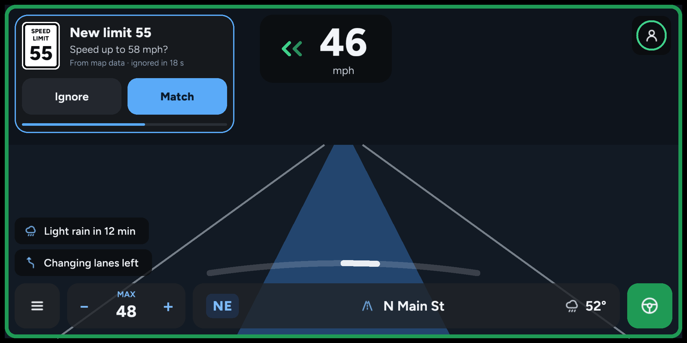
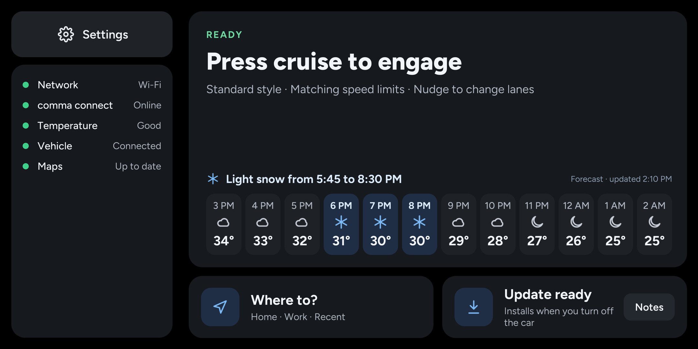
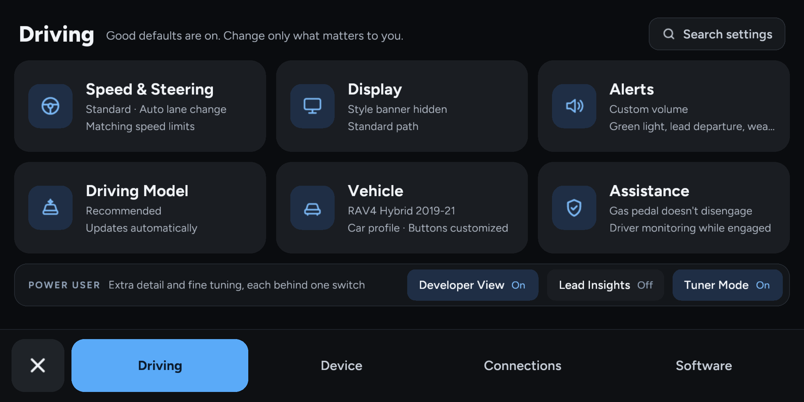
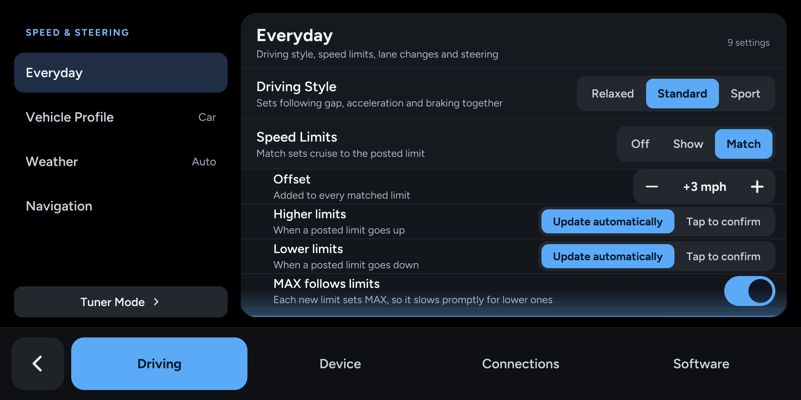
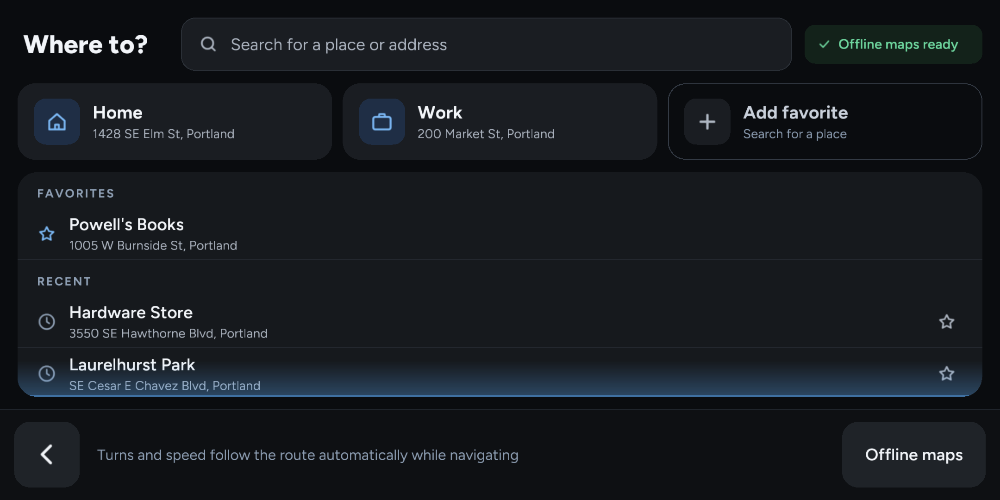
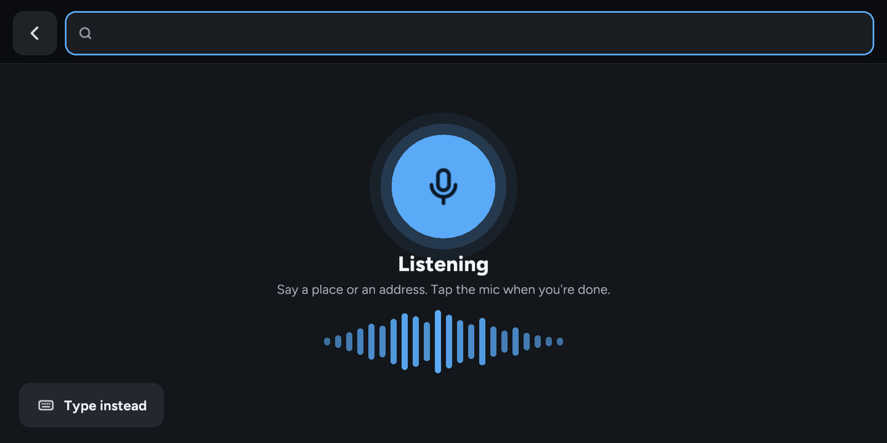
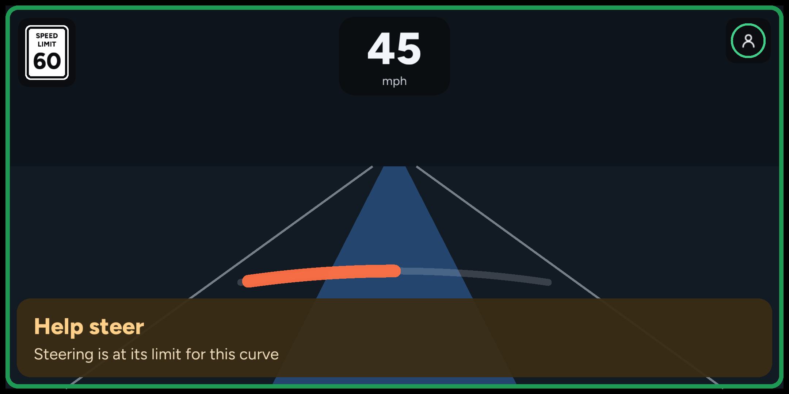

# Tandem

**Driver assistance, with the essentials in view.**

Tandem is a personal fork of [StarPilot](https://github.com/StarPilotHQ/StarPilot), built on
[comma.ai's openpilot](https://github.com/commaai/openpilot). Its design language is
**Essentials**: fewer choices, useful defaults, and clear explanations of what the car is doing.
I built this for my own preferences, and I do not encourage others to use it.

[What's new](RELEASES.md) · [Development guide](selfdrive/ui/tandem/README.md) · [Report a problem](https://github.com/jfgordon2/Tandem/issues)



## What makes Tandem different

Tandem brings StarPilot's settings, alerts, and driving information into a consistent interface.
StarPilot continues to provide the driving logic, vehicle integrations, and underlying settings.

- **The essentials while driving.** Speed, the speed limit, directions, and cruise controls stay
  in view. Short status messages explain slowing, stopping, and paused assistance. A steering arc
  shows how much steering is being used, with a Help steer alert at the limit.
- **Settings that start simple.** Four tabs group Driving, Device, Connections, and Software.
  Search finds settings by name or meaning. Driving styles set following gap, acceleration, and
  braking together; Tuner Mode opens the individual controls.
- **Speed limits on your terms.** Show limits or match them, choose whether higher and lower
  limits need confirmation, and let MAX follow each new limit.
- **Weather ahead.** A status chip warns before rain, snow, or storms start and says when
  they should stop. Parked, the home screen shows the next 12 hours.
- **Navigation from the home screen.** Search for a place, pick a favorite, and preview the route
  before starting. Voice typing works while parked and runs on the device.
- **A consistent look throughout.** Figtree type, shared controls, and plain language carry through
  setup, the parked home screen, settings, the keyboard, and alerts.
- **Control over diagnostics.** Automatic crash and diagnostics reporting is off. You can still
  send a report explicitly. Drive-log and video uploads have their own setting.

## Around the interface

| Parked home | Driving settings |
| --- | --- |
| [](selfdrive/ui/tandem/assets/screenshots/home.png) | [](selfdrive/ui/tandem/assets/screenshots/settings.png) |
| Vehicle and device status, the next 12 hours of weather, destinations, and updates. | Everyday settings together, with more detail when you want it. |

| Speed and steering | Where to? |
| --- | --- |
| [](selfdrive/ui/tandem/assets/screenshots/everyday.png) | [](selfdrive/ui/tandem/assets/screenshots/destinations.png) |
| Driving style, speed limits, and lane changes in one place. | Saved places and recent destinations, a tap away. |

| Voice typing | Help steer |
| --- | --- |
| [](selfdrive/ui/tandem/assets/screenshots/voice.png) | [](selfdrive/ui/tandem/assets/screenshots/helpsteer.png) |
| Speak a place or a setting while parked; it's transcribed on the device. | A gentle warning before steering runs out in a curve. |

## Using Tandem

In general, it would be inappropriate to use this fork over StarPilot directly.  Knowning that, if you want to try it anyway,
here's what you need to know:

Tandem uses **`release`** as its default branch and release channel in [`jfgordon2/Tandem`](https://github.com/jfgordon2/Tandem/tree/release).

Tandem inherits StarPilot's vehicle support, driving models, tuning, navigation, Bluetooth controls,
and Galaxy remote access. Available features depend on the vehicle and hardware. The
[StarPilot wiki](https://wiki.firestar.link) covers upstream hardware, installation, and configuration;
its repository and branch references describe StarPilot, so use Tandem's when installing this fork.

## Development

```sh
git clone --branch release https://github.com/jfgordon2/Tandem.git
cd Tandem
git remote add upstream https://github.com/StarPilotHQ/StarPilot.git
```

With the host dependencies installed, `./c3` runs the large UI and `./c4` runs the small UI.
`./build` produces device binaries using the configured sysroot and toolchain.
Follow the [Mac desktop UI setup guide](selfdrive/ui/tandem/docs/mac-desktop.md) for dependencies,
Python setup, launch commands, and troubleshooting. Use `./c3` for Tandem's Essentials UI.

Tandem's UI lives in [`selfdrive/ui/tandem/`](selfdrive/ui/tandem/), and its supporting code lives in
[`starpilot/tandem/`](starpilot/tandem/). Start with the [development guide](selfdrive/ui/tandem/README.md) for components, screen implementations,
screenshot tools, and upstream integration points. [AGENTS.md](AGENTS.md) documents the design,
ownership, and verification rules, including running tests without a full openpilot build.

```sh
pytest selfdrive/ui/tandem/tests
ruff check selfdrive/ui/tandem
```

Upstream updates come from `StarPilotHQ/StarPilot`'s `StarPilot` branch. Keep Tandem changes in its own modules where possible, and record
the small upstream hooks in the development guide so future merges can reapply them.

## Upstream and credits

Tandem builds on the work of StarPilot, comma.ai's openpilot, FrogPilot, and their contributors.
openpilot provides the foundation for lane centering, adaptive cruise control, lane change
assistance, and driver monitoring; StarPilot adds its vehicle integrations, controllers, and tuning.

Inherited Ford support includes substantial adaptations from
[BluePilot](https://github.com/BluePilotDev/bluepilot/tree/bp-7.0), principally developed by
[Alan Polk](https://github.com/alan-polk) with additional BluePilot contributors. Hyundai, Kia, and
Genesis angle steering and related support include adaptations from
[sunnypilot](https://github.com/sunnypilot/sunnypilot/tree/hkg-angle-steering-2025) and its
[opendbc angle-steering branch](https://github.com/sunnypilot/opendbc/tree/hkg-angle-steering-2025).

See [CREDITS.md](CREDITS.md) for code provenance and contributors. Upstream projects and contributors
do not maintain or endorse Tandem; please direct Tandem support requests to this repository.

## Third-party notices

- Portions of this software include modified versions of Google's Material Design Icons under
  the Apache License 2.0. A copy is included in [LICENSE-MDI](LICENSE-MDI).
- Ford support includes software adapted from BluePilot's `bp-7.0` branch. Its standard MIT notice
  and separate custom SUNNYPILOT LLC notice are preserved in
  [THIRD_PARTY_NOTICES.md](THIRD_PARTY_NOTICES.md).
- Hyundai, Kia, and Genesis support includes software adapted directly from sunnypilot's HKG
  angle-steering branch and sunnypilot/opendbc. Applicable notices are preserved in
  [THIRD_PARTY_NOTICES.md](THIRD_PARTY_NOTICES.md).

> This project uses software from Haibin Wen and SUNNYPILOT LLC and is licensed under a custom license requiring permission for use.
