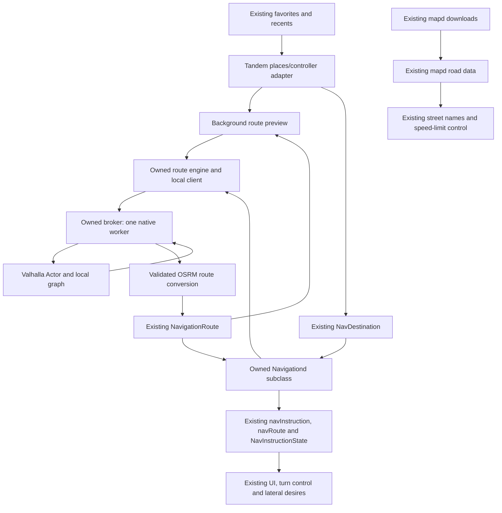

# Valhalla offline routing implementation spec

**Approved contract update, November 3, 2026:** the owner approved the [revision 2 mocks](../design/valhalla-review/revision-2/index.html), automatic inclusion of both map sets, shared Weekly/Monthly updates and shared map deletion. The later approval supersedes this original spec's default-off/local-only mode and separate data-manager/link flow. Use [the current behavior and rollback guide](valhalla-offline-routing.md) as the implementation contract: strict Offline maps only, remembered Online/Offline preference with one fallback, existing region panes, current progress layout, automatic preparation, maintained catalog and existing bottom-left chip. Historical standalone acceptance evidence below remains useful; obsolete UI/policy directions do not.

Status: proposed implementation contract for the `valhalla` branch. Written November 3, 2026 against
`78c75a0a94` (`release` at branch creation). This document specifies work; it does not claim that
Valhalla has been installed, benchmarked or integrated.

Implementation follow-up: see [setup and rollback](valhalla-offline-routing.md) and the
[device trial report](valhalla-device-trial.md) for current evidence and remaining acceptance work.

Read [AGENTS.md](../../../../AGENTS.md) and [Tandem's integration inventory](../README.md#keeping-rebases-easy)
before implementing. Recheck the named interfaces against the checkout before editing them.

## 1. Outcome and scope

A driver with routing data downloaded for the journey can select Home, Work, a favorite, or a recent
place with coordinates, preview the route, start guidance, and recalculate after a missed turn without
internet access or a Mapbox key. StarPilot still decides route progress, when to reroute, how to use
navigation for turn slowdowns and lateral desires, and what the car is allowed to do.

Deliver this in three stages:

1. **Standalone trial:** an isolated Valhalla runtime, a small routing graph, an offline benchmark and
   a report from the comma 3X. No change to live navigation or control parameters.
2. **Navigation integration:** an explicitly enabled local routing provider used by both Tandem's
   preview and StarPilot's navigation service through owned adapters. Saved places work offline.
3. **Usable data management:** owned routing-data installation, status, space accounting, update and
   removal, with Essentials UI and approved mocks. CLI installation is enough to test stage 2, but
   is not the finished driver-facing installation experience.

The initial feature does not include offline address/business search, detailed street-map rendering,
live traffic, new voice guidance, changes to driving-model inputs, or replacement of `mapd`.
Keep existing Mapbox search available for an explicit search when configured and online. Do not label
this initial feature as fully offline place search. Valhalla accepts coordinates, not address queries.

### Decisions to preserve

- Keep the existing `mapd` downloads. Add a separate Valhalla routing graph. Their common OSM origin
  does not make their prepared files interchangeable.
- Use StarPilot's existing destination storage, messages, navigation progress and control logic.
- Prefer Valhalla's OSRM response format with banner instructions over writing a new maneuver engine.
- Keep the native library outside the UI, planner and existing managed Python environment.
- Make offline routing an explicit experiment with an immediate upstream fallback switch.
- In local mode, route requests stay local. Do not silently send a failed local request to Mapbox.
- Do not add entries to the compiled Params registry or change cereal schemas for this feature.

## 2. Device evidence and unanswered performance questions

Read-only SSH checks on November 3 found:

| Item | Observation |
| --- | --- |
| Hardware | comma 3X (`tizi`), eight Qualcomm ARM64 CPU cores |
| Software | Ubuntu 24.04.5, Linux 4.9.103, Python 3.12.3, glibc 2.39 |
| RAM | Approximately 3.5 GiB total, 2.3 GiB available in a parked sample; no swap |
| Storage | Approximately 11 GiB free on `/data`; existing OSM directory about 500 MiB |
| Temperatures | CPU sensors approximately 40 to 44 degrees C in the parked sample |
| State | `IsOnroad=0`; recently booted; no Valhalla/OSRM command or Debian package found |

These are snapshots, not resource reservations or evidence of performance while driving. Recheck
before installing. A matching wheel tag does not prove that its native libraries work on this kernel.
No Valhalla route, import test, or onroad performance test has run yet.

Use the existing authorized SSH connection when available. Get connection details from the session
or a task-specific environment variable; do not put keys, Mapbox tokens, personal saved coordinates,
or private SSH configuration in this repository.

## 3. Walk the existing code paths

The paths below are repository-relative. Treat the upstream/private interfaces as compatibility
boundaries, not invitations to refactor their implementations.

| Path and interface | Current behavior | Required treatment |
| --- | --- | --- |
| `selfdrive/ui/tandem/screens.py` | Selects owned screens; `TANDEM_SETTINGS`, `TANDEM_HOME`, `TANDEM_ONROAD`, `TANDEM_SIDEBAR` each restore upstream at `0` | Preserve every fallback and test mixed switch configurations. |
| `selfdrive/ui/tandem/destinations.py`: `UpstreamPlaces`, `pick`, `can_start`, `start`, `route` | Wraps an upstream controller; saved picks open a preview; routing availability means secret Mapbox key | Supply an owned controller subclass and shared local-provider adapter. Preserve favorites, Home/Work, recent stars and End route. |
| `selfdrive/ui/layouts/settings/starpilot/navigation.py`: `StarPilotNavigationLayout` | Local list refresh; Mapbox Search Box suggest/retrieve; `_routing_available()` calls `routing_configured`; `_start_navigation()` checks availability then writes destination | Override the routing gate only in the controller instantiated by Tandem. Keep the original class and its search behavior intact. |
| `starpilot/navigation/destination_store.py` | Owns `NavDestination`, `FavoriteDestinations`, `ApiCache_NavDestinations`, IDs, normalization and recents limit | Call it unchanged. Saving coordinates does not save a route or a Valhalla alternative. |
| Recent-entry normalization and selection | Older recents may contain a name without coordinates. Upstream's recent handler searches again; Tandem's list calls `pick()` directly | Handle this case explicitly in the owned adapter. Use known matching stored coordinates if available, otherwise offer existing online search or explain why that entry cannot route offline. Never reuse an old draft or invent coordinates. |
| `selfdrive/ui/tandem/routemap.py`: `mapbox_route`, `RouteFetcher`, `start_position`, `RoutePlan` | Preview makes its own directions request; live GPS first, saved parked position without heading second; retries failures; cache key is only destination coordinates | Add a provider-neutral owned preview function. Preserve parked preview support. Fix the owned fetch/cache identity for provider, variant, position, language and bundle changes. |
| `starpilot/navigation/navigationd.py`: `Navigationd` | Takes an injectable engine but rejects an empty Mapbox token before calling it; fetches asynchronously | A different engine alone is insufficient. Add a small default-preserving route-readiness hook and select an owned subclass at the entry point. |
| `navigationd.py`: `_update_location` | Requires live in-memory `LastGPSPosition`, `hasFix`, finite position and freshness; stale threshold is 2.5 seconds when timestamp is present | Retain the live-guidance gate. A persisted position is suitable for parked preview, not evidence of a live driving position. |
| `navigationd.py`: `_maybe_update_route`, `_build_progress`, `_maybe_recompute` | Tracks progress, off-route distance and bearing, arrival and reroute timers | Reuse the run/progress pipeline. Verify destination changes, failed reroutes and final-step arrival; do not assume every inherited edge case is correct. |
| `navigationd.py`: publishers | One instruction payload feeds cereal `navInstruction` and memory `NavInstructionState`; `navRoute` publishes route geometry on generation changes | Preserve fields, units, enum spellings, validity and fresh timestamps. Keep one navigation publisher. |
| `starpilot/navigation/route_engine.py`: `NavigationRoute`, `RouteStep`, `RouteProgress` | Common route model, segment projection, banner parsing, directions, speed conversion and arrival detection | Convert local routes into this model. Its `from_mapbox_route` name describes an input shape; using it does not require contacting Mapbox. |
| `system/manager/process_config.py`: `run_navigationd`, process entries | `navigationd` runs only while started and a destination exists; `mapd` runs onroad or for download/cancel requests | Preserve these predicates. Add only the owned routing-worker registration and a lightweight enable predicate if needed. |
| `system/manager/manager.py`, `common/params_keys.h` | Manager handles offroad clearing; `NavDestination` is cleared on manager start | Keep that lifecycle, including the configured offroad timeout. Do not add automatic route restoration. |
| `starpilot/controls/lib/starpilot_vcruise.py`: `_update_nav_instruction_state`, `_get_nav_turn_control_target` | Reads current/next maneuver type, modifier and distance and applies existing longitudinal turn-control eligibility/targets | No target-law changes. Test the real published local-route state through these consumers. |
| `selfdrive/controls/lib/desire_helper.py`: `_navigation_desire`, `_nav_effective_modifier`, `_nav_turn_signal_matches` | Reads maneuver/lane state for turn and keep desires and matching-signal lane-change suppression; enforces 2.5-second instruction freshness | Preserve lateral-active, blinker, blindspot, torque, lane-width, speed, stop-hold and toggle gates. Test ambiguous forks and shared edge lanes through this actual reader. No upstream edit is planned here. |
| `starpilot/tandem/navigation.py` | Observes the turn StarPilot actually selected and publishes `NAV_TURN` | Keep observing the existing controller. Do not derive a separate turn decision directly from Valhalla. |
| `selfdrive/ui/onroad/starpilot/navigation_card.py`, `selfdrive/ui/tandem/onroad/view.py` | Turn card reads memory state and `NavigationUI`; arrival/distance bar reads `navInstruction` | Feed existing contracts. A route must appear correctly in both channels and clear correctly on End route. |
| `starpilot/navigation/mapd_wrapper.py` | Supervises `mapd`; reads its own OSM files under `/data/media/0/osm/offline`; handles missing/corrupt tiles | Leave paths, binary, corruption handling and outputs unchanged. |
| `starpilot/controls/lib/speed_limit_controller.py` | `mapdOut` supplies current/next limits, selection type and upcoming-limit distance | Keep map-source priority, current/next limit semantics and lookahead behavior. A route ETA speed is not a posted speed limit. |
| `starpilot/starpilot_process.py`, `starpilot/controls/starpilot_planner.py`, `starpilot/system/speed_limit_filler.py` | StarPilot's process subscribes to `mapdOut` and supplies the planner/controllers; the filler reads road names | Inventory exact downstream field use again at implementation time. Do not fabricate mapd messages from the route response. |
| `starpilot/controls/lib/mapbox_speed_limit.py` | Separate online Mapbox **Matching** request for filling speed-limit gaps | Local routing does not replace this service. Its online policy and `SLCMapboxFiller` remain existing behavior. Do not claim that the entire device makes zero network requests. |
| `selfdrive/ui/tandem/settings/maps.py`, upstream maps controller | Owns the Essentials wrapper, maps selections, `DownloadMaps`/`CancelDownloadMaps`, mapd progress and storage | Reuse visual components and region vocabulary where useful. Give routing downloads their own state and ownership. |
| `starpilot/common/maps_selection.py`, `maps_catalog.py`, `maps_download_progress.py` | Existing map-region catalog/selection and mapd storage reconciliation | Useful reference and shared region identifiers, not a Valhalla package manifest or proof of routable coverage. |
| `starpilot/system/the_galaxy/the_galaxy.py`: `/api/navigation` and favorite endpoints | Saved coordinates/favorites are local; `POST /api/navigation` rejects missing secret key | Document this entry point explicitly. Stage 2 covers Tandem device navigation; preserve Galaxy's existing API behavior. A later Galaxy-local-routing extension needs a scoped capability hook and HTTP tests. |
| Galaxy `assets/components/navigation/navigation_destination.js`, `navigation_utilities.js` | Browser search, Mapbox GL/CDN/style and directions requests; `main`/`alt-N` IDs | These remain an online browser flow. Changing only the destination API gate does not make Galaxy offline. Do not rewrite or vendor this upstream frontend for stage 2. |

Read the implementations and tests rather than trusting only this table. In particular, route data is
used for actual turn-speed behavior. Rendering a plausible route line alone does not satisfy the spec.

## 4. Owned architecture

Put backend additions under `starpilot/tandem/routing/` and UI changes under `selfdrive/ui/tandem/`.
Do not turn the existing `starpilot/tandem/navigation.py` observer into the routing engine.

Suggested module boundaries; combine small modules when that makes the implementation clearer:

| Owned module | Responsibility |
| --- | --- |
| `starpilot/tandem/routing/config.py` | Effective enable state, runtime/data paths and small shared configuration; no native library import |
| `starpilot/tandem/routing/bundles.py` | Bundle manifest, compatibility, selection, installation, storage and removal |
| `starpilot/tandem/routing/client.py` | Bounded local IPC, status and request/result contracts; no UI or native-library dependency |
| `starpilot/tandem/routing/routingd.py` | Lightweight managed broker and supervision of one native worker |
| `starpilot/tandem/routing/native_worker.py` | Loads Valhalla in its dedicated runtime, owns the Actor and serializes native calls |
| `starpilot/tandem/routing/normalize.py` | Pure validation and OSRM-to-StarPilot route-data conversion |
| `starpilot/tandem/routing/route_engine.py` | Implements the existing `fetch_route(token, start, destination, bearing)` shape; returns `NavigationRoute` or `None` |
| `starpilot/tandem/routing/navigationd.py` | Owned subclass/factory around upstream `Navigationd`; local capability and request lifecycle |
| `starpilot/tandem/routing/tools/` | Reproducible runtime/bundle preparation, trial install, benchmark and inspection commands |
| `starpilot/tandem/tests/test_routing_*.py` | Backend contracts, hooks, lifecycle and conversion tests |
| `selfdrive/ui/tandem/destinations.py`, `routemap.py` | Owned controller wiring, preview state and driver-visible status |
| `selfdrive/ui/tandem/settings/` | Owned routing-data management and configuration |



### 4.1 Enable policy and upstream fallback

Use an owned `offline_routing` preference, default **off**, following `prefs.Flag`/`.tandem_*`
storage conventions. Preserve ordinary preference backup/restore. Avoid a backend import that loads
raylib merely to read the preference; the existing preference helpers themselves are lightweight.

Define `TANDEM_ROUTING=0` as a hard override to upstream routing. `TANDEM_ROUTING=1` may explicitly
enable a development session. Otherwise read the owned preference. For the first experiment, any
existing screen switch set to `0` disables the local routing experiment as a whole. This conservative
rule keeps shared navigation behavior aligned with upstream screens in mixed configurations.

All factories, UI adapters and worker predicates must call the same effective-enable helper. Missing
preferences mean upstream behavior. Missing Valhalla packages must not stop the UI, manager, or
ordinary Mapbox navigation from importing when the experiment is disabled.

Change provider preference only while parked and after ending the active route. Starting/stopping
the owned worker must work through the manager's ordinary lifecycle. Do not run a second navigationd
or publish competing navigation messages. Native-worker failure must not disable driving processes.

In enabled local mode, missing runtime/data yields a specific unavailable state. Switching back to
online routing is explicit, not an automatic fallback following a local error.

### 4.2 Keep upstream edits limited to hooks

The intended upstream change budget is two source files:

| Unowned file | Minimal integration |
| --- | --- |
| `starpilot/navigation/navigationd.py` | Add an overridable route-readiness method whose default is the current token check; use it at the existing pre-fetch gate. Add a lightweight class factory call in `main()` to select the owned subclass only when enabled. |
| `system/manager/process_config.py` | Register the owned broker with an owned runtime predicate and low priority. Keep the original `navigationd` and `mapd` process identities and predicates. |

For example, the readiness seam can accept the already-read token and default to `bool(token)`.
The owned subclass can then accept a ready local provider with an empty token. Never put a dummy
secret into Params or return a fake token just to bypass the existing guard.

The upstream controller's `_routing_available()` is already overridable: subclass it in owned code,
so it needs no upstream UI edit. Do not broaden the shared `destination_store.routing_configured()`
function to return true globally. Doing so would change upstream UI and Galaxy semantics.

Keep default behavior identical, including the existing engine injection seam. Do not copy the
navigation run loop, fork the full route engine, monkey-patch module globals, or add offline logic to
upstream controls. A small owned override for lifecycle behavior is acceptable when backed by a
specific failing integration test; do not use it to accumulate unrelated upstream fixes.

List **every** unowned edit in README's Upstream integration table, including changes to an already
listed file. If another hook proves necessary, explain why an owned adapter cannot handle it and add
the smallest compatible seam. Do not edit unowned dependency manifests, generated libraries, Params
binaries or schemas to package Valhalla.

## 5. Native runtime and local service contract

### 5.1 Package and isolation

Start by evaluating pinned `pyvalhalla==3.9.1`, not an unpinned latest package. Published documentation
describes Linux ARM64 wheels; record the actual wheel filename, checksum, Python ABI, native version,
dependencies and import result in the trial report. If this version fails, record the failure and
select another pinned version deliberately. Verify the installed version's API rather than assuming
current website documentation describes it exactly.

Install into an owned runtime directory, for example:

```text
/data/tandem/navigation/
  runtimes/<runtime-id>/          # separate environment and dependency manifest
  bundles/<bundle-id>/           # immutable installed graph and metadata
  staging/<install-id>/          # incomplete transfers/build outputs
  active.json                   # atomic selector for a compatible graph generation
  benchmarks/<run-id>/           # local results; outside drive-log upload folders
```

Provide test overrides for these paths. Keep source, scripts, small fixtures and manifests in owned
repo paths; do not commit wheels or regional graphs. Stage 1 must be removable as a unit. Do not
install into `/usr/local/venv`, edit global pip packages, change the OS, or rebuild the device's
existing dependencies to make the trial work.

The broker runs in the ordinary managed environment. Its native child runs with the explicit Python
executable from the dedicated runtime. One persistent Actor serves preview and active-navigation
requests, one native call at a time. This avoids loading separate graph caches in UI and navigationd.
The native child may crash or hang without taking either caller with it.

### 5.2 IPC and scheduling

- Prefer an owned Unix-domain socket under `starpilot/tandem/state.py`'s runtime directory. Keep it
  device-local and owned by the expected user; no public HTTP listener or new Galaxy endpoint is needed.
- Use a versioned, bounded message format. Include request ID, caller/generation, start coordinates,
  optional heading, destination, normalized alternative request, language and active bundle generation.
- Return success with route data, or a typed status: `disabled`, `runtime_missing`, `data_missing`,
  `data_incompatible`, `outside_coverage`, `no_route`, `busy`, `timeout`, `worker_failed`, `invalid_request`.
  Keep UI wording separate from backend error codes. Do not put arbitrary native exceptions on screen.
- Bound payload size, queued work and execution time. Serve active navigation/reroutes ahead of
  speculative previews. Coalesce superseded previews; do not start an unbounded thread per frame.
- Check response IDs/generations at both ends. A late result must not overwrite a newer destination,
  End route, a provider change, a dataset change, or a newer reroute position.
- Use finite connect/read/compute deadlines. Killing/restarting a stuck native child must complete
  outstanding calls with an error and leave the broker able to accept a later request.
- Limit restart frequency. Retry transient failures with a bounded backoff; wait for a configuration
  change after permanent incompatibility. Do not retry an impossible route every frame.
- Lazy-load the Actor; release it after an offroad idle timeout. Keep it warm while a route is active.
  Read existing state or use an owned lease rather than adding upstream lifecycle fields.
- Keep low scheduling priority, following the existing `nice=19` navigation/map services. Measure
  actual CPU/RSS/PSS effects. Do not cap virtual address space as if it were resident memory: graph
  files can be memory-mapped. Do not drop the system page cache or alter global VM settings to benchmark.

Configure native routing to use local graph files only. Disable remote graph fetches and other
on-demand downloads; an absent tile is an error, not a network opportunity. No Mapbox token belongs
in the local request. Installation/download tooling may access the network while parked; route
computation is a separate operation with no internet dependency.

## 6. Wire Valhalla into the existing route contract

### 6.1 Request and response format

Use `costing: auto`, `format: osrm`, `shape_format: geojson`, `banner_instructions: true` and
instruction output. Ask for local speed-limit shape annotations through the pinned version's supported
attribute-filter API. Verify that annotations and banner lanes actually appear in a generated fixture.
Do not assume Mapbox query parameters such as `annotations=maxspeed` work unchanged on Valhalla.

Use start/destination coordinate objects, not a geocoding call. Send a finite live heading with a
heading tolerance matching the existing routing intent; omit an old parked heading. Request full
route geometry without display-oriented simplification. Check the pinned version's accepted option
for that behavior rather than guessing a `generalize` value.

Map the user's supported UI language to a supported narrative language and use a documented fallback.
Do not translate proper street names through Tandem's string catalog. Keep ETA estimates local;
without a traffic feed, do not present them as live-traffic estimates.

### 6.2 Normalization table

Produce the input contract accepted by `NavigationRoute.from_mapbox_route`, then reuse its ordinary
progress/publisher pipeline. Keep conversion pure enough to test without native Valhalla or hardware.

| Valhalla OSRM result | StarPilot route data | Required handling |
| --- | --- | --- |
| Selected `routes[]` entry | One `NavigationRoute` | Validate success, route count and selected index. Reject unsupported/malformed legs rather than silently discarding them. Initial requests have two endpoints. |
| GeoJSON route `geometry.coordinates` | `geometry` list of latitude/longitude objects | OSRM order is longitude, latitude. Validate finite values, bounds, usable geometry and continuity; keep annotation alignment. |
| Route `distance`, `duration` | `totalDistance`, `totalDuration` | Meters and seconds, finite and nonnegative. Do not confuse native default distance units with OSRM units. |
| Leg `steps[]` | `steps` | Preserve departure and final arrival. Require ordered locations/distances; handle duplicate shape points and short routes. |
| Step `maneuver.type`, `modifier`, `location`, instruction | `maneuver`, `modifier`, `location`, `instruction` | Preserve recognized OSRM meanings. Confirm the pinned serializer's instruction field and validate fallback text. Do not map an unknown type to an arbitrary turn. |
| Step distance/duration | Step `distance`, `duration` | Preserve units and step ordering; no negative or nonfinite values. |
| `bannerInstructions` | `bannerInstructions` | Retain upcoming-maneuver timing, primary/secondary text and lane subcomponents. Validate the subset the existing parser reads. |
| `annotation.maxspeed` | Position-aligned speed-limit data | Handle known numeric units and unknown/unlimited entries explicitly; never use routing travel speed as the legal limit. |

The versioned OSRM serializer supplies banners on the preceding step for the upcoming maneuver.
Use that convention; do not shift banners a second time. Prove correct behavior before, at and after
a turn using the existing `get_progress()` and `build_instruction_payload()` methods.

### 6.3 Maneuvers, lanes and speed limits are integration requirements

Test at least departure, continue/new-name, left/right/slight/sharp turns, fork/keep, ramps/exits,
merge, U-turn, roundabout entry/exit and arrival. Preserve each distinction through the normalized
route and publisher. Unsupported maneuvers must degrade explicitly, not become a false turn slowdown.

The current parser expects a banner `sub.components` lane with `active`, `directions` and optional
`active_direction`; enum conversion accepts only its existing lane vocabulary. Validate these fields,
including left/right driving, shared-direction lanes, multiple active lanes, missing lanes and
directions not representable by cereal. Keep lane order. Missing OSM lane data means empty/unknown
lanes, not a guessed lane count or active road-edge lane.

Maneuver type/modifier/distance affect `_get_nav_turn_control_target()`. The lane fields also affect
`DesireHelper._nav_effective_modifier()` and lateral keep/turn decisions. Trace the resulting
`laneCount`, `activeLaneDirection`, `activeLaneIndex`, `activeLaneAtRoadEdge`, `hasSharedSameSideLane`
and `sameSideLaneCount`, plus the current/next maneuver, through the existing publisher into the
appropriate consumers. Missing lane data must not create a claimed road-edge turn opportunity.
Preserve driver-signal matching and suppression of a lane change when that signal belongs to an
upcoming routed intersection turn. Do not turn a generic fork into an intersection-turn desire.

Keep a speed annotation slot for every covered segment. The current upstream builder filters invalid
maxspeed entries before indexing them, which can move later limits to the wrong segment. The owned
normalizer must preserve unknown/unlimited positions with a safe unknown value, or use an owned route
subclass for aligned lookups. Do not compress the annotation list. Treat unknown/unlimited as no
usable numeric posted limit, not infinity or an arbitrary high value.

Also note that upstream currently stores a selected speed on each `RouteStep`; it is not a continuous
per-segment speed-limit service. Preserve/document that granularity, or implement an explicitly tested
owned lookup if publishing more precise local-route limits. `mapd` remains the authoritative existing
map-source service for current and upcoming limits. Do not overwrite its result with an ETA speed.

Do not require a second native map-matching request per GPS update to complete this feature. Route
annotations plus existing `mapd` are the first integration. Replacing `mapd` with Valhalla map matching
would need a separate spec for live road selection, current/next limits, distance and name outputs.

### 6.4 Stored alternatives

Existing `routeId` values are `main` or `alt-N`, representing an index in a Mapbox result, not a
persistent path. They do not identify the same route in Valhalla. Keep favorite IDs and stored payloads
unchanged; interpret the field at the provider boundary.

For the local provider, use `main` by default. If an old favorite requests `alt-N`, show that the route
will be recalculated locally and clear the variant only in the local request copy. Do not silently
claim to honor the old chosen alternative or rewrite the favorite's ID. Add native alternatives later
only with provider-specific request identity, consistent preview/Start behavior and tests for a missing
alternative. The first release does not need an alternative-route picker.

## 7. Preview, starting, guidance and failures

### 7.1 Shared capability, separate search

Create one shared capability/status API used by the owned controller, preview and navigationd adapter.
It distinguishes enabled provider, installed compatible runtime, graph availability/generation,
worker health and request-specific coverage. A nonempty Mapbox key, a running process or a mapd
storage count alone does not prove local routing readiness.

`UpstreamPlaces` should instantiate an owned `StarPilotNavigationLayout` subclass when local routing
is enabled. Its availability override reads the shared capability API. Let the upstream start action
continue writing the destination through the existing store, updating recents and clearing the draft
only after acceptance. Keep the original controller instance when the experiment is disabled.

Keep `can_search()` based on the existing public-key/search flow. Opening a valid favorite must not
invoke suggest/retrieve or require either Mapbox key. A name-only recent must take the explicit
resolution path described above. Search errors must not disable valid stored favorites.

### 7.2 Preview and Start

- Use the same provider, graph generation, request normalization and route conversion for preview
  and active navigation. The preview is background work and never writes `NavDestination` by itself.
- Preserve live-GPS-first/saved-parked-position-second preview behavior. Saved heading is omitted.
  Explain a missing position separately from missing data or a routing failure.
- Extend the owned fetcher's cache/request identity beyond latitude/longitude: include start position
  within a documented movement tolerance, usable heading, provider, requested variant, language and
  graph generation. Expire preview results after a documented short interval. Do not reuse an old
  preview after the vehicle moved or a bundle changed.
- In local mode, enable Start for a valid draft only after a matching route preview succeeds and the
  selected provider/data remain available. Pending/failure states keep the draft recoverable.
- Recheck provider/generation/position at Start. A saved-position preview may be shown while parked;
  actual guidance still waits for a fresh live fix. Explain the waiting state instead of declaring
  that the cached parked fix is live.
- Initial integration may recompute once at Start, as today. Any shared preview-to-guidance cache
  must be bounded and keyed by the full request identity. Do not reuse solely by destination name
  or coordinates. A durable route cache is not a substitute for an offline router.

### 7.3 Active route lifecycle

Use upstream `Navigationd.run()`, route progress and publishers. The owned subclass supplies local
readiness and an engine that contains IPC/native errors, so the upstream async worker always gets
a finite result. Preserve the one-payload-for-both-publishers behavior and timestamp refresh test.

Verify and handle these cases in owned lifecycle overrides where necessary:

1. Destination A is fetching when B replaces it: invalidate A immediately; its late result must never
   become B's guidance. Use owned generation/cancellation state, not new upstream state fields.
2. A has a route, then B fails: stop publishing A as if it belonged to B. Preserve B as a recoverable
   destination with no valid guidance and a clear failure/waiting state.
3. Same destination, missed turn: use StarPilot's reroute triggers. If a local reroute fails, retain
   the previous route only as data; suppress actionable guidance while the fresh position is known
   to be off that route. Retry with backoff without blocking GPS updates.
4. End route/provider change: invalidate in-flight work, clear route state through the existing store,
   publish invalid/empty navigation state and reject subsequent stale results.
5. Lost/stale GPS: no valid instruction or turn-control state. Resume with a fresh fix under existing
   behavior. No persisted-position fallback for live guidance.
6. Arrival: exercise the final step and stationary destination. The current `_maybe_recompute()`
   returns early at the final step; verify that arrival clearing actually runs before relying on it.
   If the scenario fails, fix the local subclass narrowly and keep disabled upstream behavior intact.
7. Worker death, timeout, graph removal or service restart: clear local readiness and invalid guidance
   as appropriate; do not leave a latched turn state. Reconnect/retry in a bounded way.
8. Ignition/offroad/manager restart: preserve the existing manager clear timeout and
   `CLEAR_ON_MANAGER_START` policy. Do not create route-restoration behavior as a side effect.

Keep StarPilot's maneuver eligibility, lateral/longitudinal authority, target speeds and selected-turn
observer unchanged. A local route is a different source of route data, not a new driving policy.

There is an important existing reader difference: `DesireHelper` checks instruction age, while
`_get_nav_turn_control_target()` checks `valid` without an equivalent timestamp check. For the local
provider, close the producer-death/stale-state gap at an owned lifecycle/freshness boundary and test
both consumers. A consumer-side guard, if needed, belongs in the existing owned cruise subclass and
is enabled only for this experiment; it must validate freshness before delegating, not calculate new
targets. A producer/supervisor cleanup must identify its local generation and never erase state from
the upstream provider. Merely writing timestamps does not make a reader enforce them.

## 8. Data preparation, installation and management

### 8.1 Two map datasets

| Dataset | Owner and lifecycle |
| --- | --- |
| `/data/media/0/osm/offline` | Existing mapd data and upstream download/cancel/remove rules |
| `/data/tandem/navigation/bundles` | Owned Valhalla routing data and independent installation/update/removal |
| Future offline search/display files | Separate follow-up; neither is implied by installing a routing graph |

Do not put Valhalla files inside the OSM directory, include them in `MapsDownloadSizeCache`, or reuse
`DownloadMaps`, `CancelDownloadMaps`, `MapsDownloadProgress` or `mapdExtendedOut` for Valhalla work.
Existing Remove offline maps must keep its current scope. Routing-data removal must only touch its
owned bundle paths. Account for both datasets in total device storage without counting either twice.

The existing region catalog/selection helpers may supply familiar labels or a user-requested region
list. A routing package needs its own manifest and coverage validation. An endpoint bounding box
does not prove that all roads between the endpoints are installed.

### 8.2 Reproducible bundles

Build routing graphs off-device from a known OSM extract with the pinned Valhalla builder/runtime
combination, or use a verified compatible prebuilt bundle with recorded provenance. Do not build a
large state/country graph on the comma while openpilot runs. A tiny synthetic graph for tests is fine.

The install manifest must record at least:

- Manifest schema and immutable bundle ID/generation.
- Valhalla builder version/commit, tested runtime compatibility and build settings.
- OSM source URL/provider, extract timestamp/checksum, build timestamp, coverage geometry and known gaps.
- File list, hashes, download bytes, installed bytes and required temporary/rollback space.
- Included routing features such as language support, lane/maxspeed data and required ancillary files.
- OpenStreetMap attribution and applicable data license; software dependency/license manifest.

Copy required runtime ancillary files only when the pinned configuration actually uses them. Keep
data-generation dependencies on the build computer, not in the device's ordinary environment.

Validate a staged bundle completely before switching `active.json` atomically. Reject incompatible,
truncated, corrupt or incomplete data. Check free space for the new bundle, staging and any retained
previous generation; do not assume 11 GiB will always be free. Keep the last usable generation until
validation succeeds, and make rollback explicit.

Use path-safe installation/removal; reject archive traversal and unexpected links. A request can name
an installed bundle ID, not an arbitrary filesystem path. Concurrent install, cancel, remove and route
requests must have defined locking/lease behavior. Do not delete graph files held by an active route.

Adjacent regions must form one compatible connected graph for cross-boundary routes. Do not concatenate
independently generated archives or overwrite overlapping tile IDs and assume the result works. Build
the required union or verify a common-generation tiled distribution. Test routes across boundaries and
through a third region. Missing interior coverage must report an error, not trigger an online fetch.

### 8.3 Essentials UI

Prepare proposed **new mock variants** before UI code; do not edit approved mocks without owner approval.
Follow the component library, `T.px()`/`T.font_px()`, translation and settings-search conventions.

The current Where to? badge says "Offline maps ready" solely from mapd storage. Replace or qualify
that presentation in the approved local-routing design so drivers can distinguish road data from
routing data. Show routing availability, installed region/age, missing journey coverage, preparation,
failure and waiting-for-GPS states accurately. Do not infer "this journey works offline" from any
nonzero storage count.

Use owned settings components for local-routing preference, installed routing regions, space used,
download/install progress and removal. Keep existing mapd controls and progress accurate. Require
parked state for preference changes and data mutation; downloads also need a connection. Cancellation
must leave installed good data available. Active routes lease their data until ended.

Update the Mapbox help/settings/search wording: public key remains for online place search; secret key
is for online routes and the separate optional speed-limit filler. It is not required for a ready local
route. Scope wording changes to owned UI, not upstream's original screens or Galaxy frontend.

Mark all new driver-visible text with `N_`, `t_` or `tn_`; run the catalog update, search-index checks,
pseudo-language scene and fallback-font process if needed. Add new scenes and compare entries. Capture
mock and built screenshots, inspect them and update README's mock-difference notes when appropriate.

## 9. Verification and rollout

### 9.1 Stage 1: standalone trial

Provide repeatable commands in an owned tool/README. Each run writes a machine-readable result plus
a short human report under an ignored/local output directory. Record hardware/OS, source revision,
runtime/wheel hashes, dataset generation/coverage, parameters, baseline and measured results.

1. Recheck device free space, available RAM, parked state and existing workload.
2. Prepare the dedicated runtime and a small graph off-device; transfer and verify checksums.
3. Smoke-test native import/configuration and one known route. Capture real OSRM output for adapter
   work, including turn, banner/lane and speed-limit examples where the graph has them.
4. Benchmark short urban, rural and highway routes, a longer regional route, changed-origin rerouting,
   no-path cases and boundary cases. Use public/synthetic coordinates in committed fixtures.
5. Measure cold process start plus first route, warm p50/p95, peak aggregate broker/child RSS/PSS,
   CPU time, installed bytes, page-cache effects and temperature change. A fresh process is not
   evidence of a cold kernel file cache; label that distinction. Repeat enough requests for useful p95.
6. Prove local operation with networking unavailable to the native routing process or equivalent
   network-call tracing. Keep SSH/device networking available. Do not disable interfaces remotely
   or infer offline operation simply because a network cable is absent.
7. Inject corrupt/missing data, worker crash/hang, request supersession and service restart. Confirm
   timeouts, recovery and no leaked children or unbounded resident-memory growth.

Initial engineering targets, to evaluate rather than present as measured facts:

| Metric | Trial target |
| --- | --- |
| Warm short/local routes | p95 at most 2 seconds |
| Warm regional route set | p95 at most 5 seconds |
| Cold process plus first supported route | At most 10 seconds |
| Broker plus worker peak resident memory | Aim below 384 MiB; investigate any result above 512 MiB |
| Failure completion | Bounded deadline, initially 15 seconds including worker start; responsive UI throughout |
| Steady idle | No route recomputation loop; native memory can be released offroad |

Do not lower targets or omit hard routes simply to pass. Report results and revise the proposed
budget explicitly if the evidence warrants it. Parked success is enough to proceed to integration,
not enough to assert driving-workload compatibility.

Do not start a second navigation publisher, write a real destination, fake ignition/onroad parameters,
or feed replay messages onto live vehicle/control channels during the standalone trial.

### 9.2 Automated contracts

Add meaningful owned tests covering:

- Effective enable policy, all-off and mixed upstream switches, absent native packages and empty keys.
- Manifest validation, incompatible runtime, hash mismatch, staged cancellation, insufficient space,
  atomic activation/rollback, active-data leases and independent mapd removal/accounting.
- Native-response fixtures and normalization, units/coordinate order, unknown speed slots, banner
  timing, maneuver variants and valid cereal lane enums. Include a route whose speed changes with
  an unknown slot between two known limits.
- Pure-JSON/pure-converter tests that do not require hardware, network, or Valhalla installation.
- Optional native integration tests with a reproducibly generated tiny graph and no network. An
  unavailable native dependency must be reported distinctly from ordinary unit-test success.
- Shared-provider use by preview and navigationd; valid saved picks with no suggest/retrieve and no
  Mapbox keys; name-only recents; pending/error Start; moved start; dataset/language/variant changes.
- Generation races A-to-B and A-to-B-to-A, cancellation/End route, failed new destination, failed
  off-route reroute, worker crash/timeout and bounded retry. No stale route may produce a turn target.
- Live GPS freshness and parked-preview fallback; actual final-step arrival; manager offroad/clear
  behavior; consistency of `navInstruction`, `navRoute` and `NavInstructionState`.
- Existing longitudinal controller, `DesireHelper` and selected-turn observation: missing/shared
  lanes, forks, a next turn and matching signals must preserve existing decisions for equivalent
  valid input states. Stale local producer state must not request a speed target or lateral desire.
- Disabled mode keeps original factories, key gates, Galaxy endpoint responses and Mapbox requests.

Run the ordinary required checks plus focused upstream navigation tests in an environment where their
dependencies are available. Preserve all tests; do not weaken them to accommodate local routing.

```sh
pytest selfdrive/ui/tandem/tests
pytest starpilot/tandem/tests
ruff check selfdrive/ui/tandem
ruff check starpilot/tandem/routing starpilot/tandem/tests
git diff --check
python3 selfdrive/ui/tandem/tools/upstream_audit.py --check
```

Focused existing navigation/control regressions, where cereal and other dependencies are available:

```sh
pytest starpilot/navigation/test_destination_store.py starpilot/navigation/test_route_engine.py \
  starpilot/navigation/test_navigationd.py selfdrive/controls/tests/test_navigation_desires.py
```

If the full openpilot build is unavailable, use the AGENTS stand-ins for the UI suite:

```sh
PYTHONPATH=$PWD/selfdrive/ui/tandem/tools/render:$PWD BIG=1 xvfb-run -a python3 -m pytest -q -c /dev/null \
  --confcutdir=selfdrive/ui/tandem -p stub_plugin selfdrive/ui/tandem/tests \
  --ignore=selfdrive/ui/tandem/tests/test_headroom_warning.py --ignore=selfdrive/ui/tandem/tests/test_home_layout.py \
  --ignore=selfdrive/ui/tandem/tests/test_limit_offers.py --ignore=selfdrive/ui/tandem/tests/test_onroad.py
```

Report those four exclusions and any unavailable cereal/native/device tests. Backend test commands
may need an isolated fixture/plugin for cereal; put new stand-ins in owned test tooling, and record
the exact command instead of claiming that UI stand-ins cover all navigation/control tests.

For UI changes, run `tools/translations.py update`, the affected render scenes and pseudo-language
scene, `tools/shoot_mocks.js`, and `tools/compare.py` per AGENTS. Inspect the images and share the
comparison page. Tests do not replace that visual check.

### 9.3 Integrated device acceptance

First validate messages and lifecycle in an isolated test prefix/replay environment. Then run the
device feature with the existing manager supervising it. Driving-workload measurements need a
normal, user-supervised session; do not simulate engagement or change driving authority over SSH.

The feature is acceptable when:

- Home, Work, favorites and coordinate recents preview and navigate with no data connection and no
  Mapbox keys; missed turns recalculate locally within the measured budget.
- Missing runtime/data/coverage and lost GPS are distinguishable and recoverable. New address search
  remains clearly identified as online. No false "ready" badge is based solely on mapd downloads.
- Existing speed signs, current/next limits, street names and turn slowdown behavior retain their
  existing sources/logic. Missing lane tags do not produce invented control guidance.
- End route, destination replacement, arrival, ignition/offroad, worker failure and reboot leave no
  stale actionable route state or orphan worker.
- Resource measurements alongside the actual driving workload show no new deadline/missed-frame
  warnings, OOM events or unacceptable latency/thermal regressions against a comparable baseline.
  Record the measurements; do not infer this from total CPU idle percentage while parked.
- Routing-data update/removal cannot corrupt the installed good graph or affect mapd's files.
- `TANDEM_ROUTING=0`, the default-off preference and each existing upstream UI switch restore the
  documented upstream behavior with no native dependency required.
- README integration inventory, route/mock differences, setup/rollback instructions and test report
  are current. Add release notes only when preparing an actual release, not just the trial.

## 10. Agent work order and deliverables

1. Read the code paths in section 3, record any drift, and add a focused compatibility checklist.
2. Implement the standalone preparation/install/benchmark tools and produce a device report. Keep
   the runtime outside existing dependencies and leave live navigation unmodified in this stage.
3. Build pure normalizer fixtures/tests from the pinned OSRM output. Prove maneuver timing, lane
   fields and speed alignment before wiring a result into control-facing state.
4. Implement bundle validation, the supervised broker/native worker and bounded client contract.
5. Add the owned backend navigationd adapter, headless controller/preview adapters and the two scoped
   upstream integrations. Test generation races, keyless local routing, failure cleanup and disabled
   mode. Complete the mock work below before integrating changed visible behavior into screens.
6. Prepare driver-facing mock variants and data-management flows, including readiness, Start-button
   states and errors. Mocks must precede the changed screen code. Get required approval before
   changing approved mocks, then implement using the component library and complete translations,
   search indexing, renders and comparison QA.
7. Run the required automated and isolated integration checks; then collect integrated device
   performance/acceptance evidence. Do not claim device verification for unrun scenarios.
8. Deliver an implementation summary listing owned changes, every upstream hook, graph/runtime
   installation sizes, measured timing/memory, known coverage/data limits, failed/unrun checks and
   exact instructions to disable or remove the experiment.

The initial region, bundle distribution host and production update cadence are not fixed here.
Choose a small public extract for the standalone trial; obtain the owner's intended coverage before
large personal-region downloads. Production distribution must be reproducible and checksum-verified.
Do not let that hosting decision block a local graph/adapter proof, and do not present a trial-only
transfer script as finished production map distribution.

## 11. Primary references

Use these to verify the pinned native contract; do not blindly follow `master` when running a release.

- [pyvalhalla 3.9.1 packaging and local Actor usage](https://pypi.org/project/pyvalhalla/3.9.1/).
- [Valhalla 3.9.1 route API](https://github.com/valhalla/valhalla/blob/3.9.1/docs/docs/api/route/api-reference.md):
  coordinate inputs, output choices, heading, language, alternatives and the geocoding boundary.
- [Valhalla 3.9.1 OSRM serializer](https://github.com/valhalla/valhalla/blob/3.9.1/src/tyr/route_serializer_osrm.cc):
  actual banner/lane placement and annotation output. Inspect fixtures as well as documentation.
- [Valhalla 3.9.1 attribute controller](https://github.com/valhalla/valhalla/blob/3.9.1/valhalla/baldr/attributes_controller.h)
  and [route action](https://github.com/valhalla/valhalla/blob/3.9.1/src/thor/route_action.cc):
  verify shape-attribute filters without removing required route fields.
- [Valhalla 3.9.1 trip-leg builder](https://github.com/valhalla/valhalla/blob/3.9.1/src/thor/triplegbuilder.cc):
  check speed-limit shape alignment when testing conversion.
- [Valhalla source/build documentation](https://valhalla.github.io/valhalla/building/) and
  [repository](https://github.com/valhalla/valhalla): graph tooling and version-specific dependencies.
- [Librescoot's local navigation deployment](https://librescoot.org/en/docs/dev/navigation.html):
  an embedded deployment precedent, not a performance benchmark for comma hardware.

Local source and tests named in section 3 are the authority for Tandem/StarPilot behavior.
